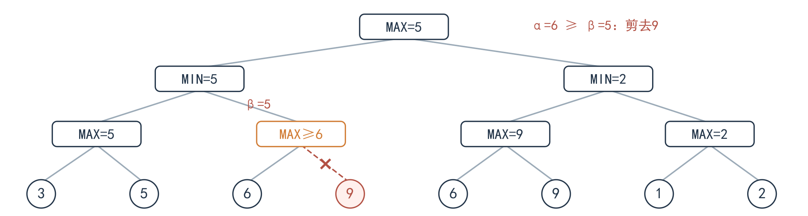
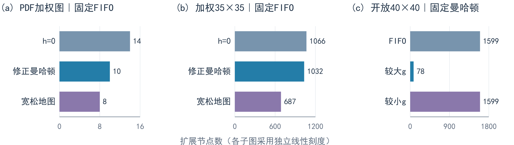
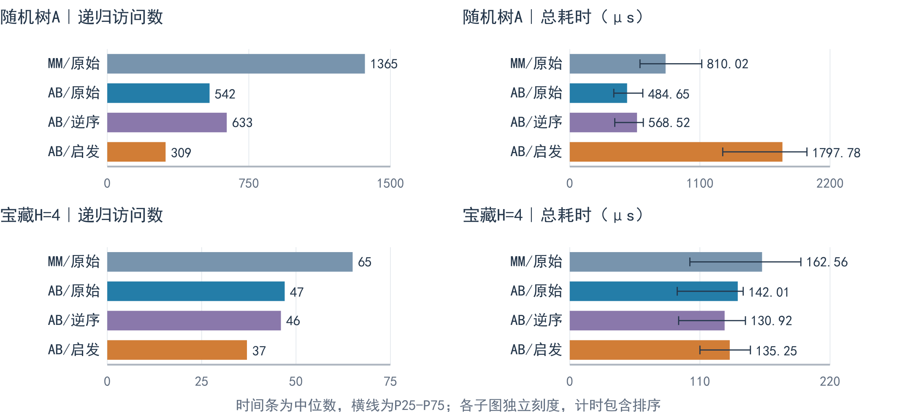

### **当代人工智能实验二：搜索算法实验报告**

##### 10242140453  刘瀚铭

#### 1. 实验目标、设计与设置

依据《实验二要求_new.pdf》第3至15页实现四方向 A*、Minimax、Alpha-Beta 和竞争宝藏分配，并按第16至17页开展正确性、搜索效率及轻量创新对照。重点检验三个问题：启发函数怎样影响展开；E 的零代价如何改变下界；行动顺序与搜索深度怎样影响博弈决策和剪枝。

**A* 设计。** 状态为坐标 `(row,col)`，`g` 为已付代价，`h` 为到目标的下界，`f=g+h`。堆元素记录 `(f,secondary,serial,g,coord)`，用严格更小的 g 更新父指针；跳过过期堆项，允许节点重开，弹出有效目标后逆向重建路径。四邻居顺序固定为右、下、左、上。题一返回含起终点的坐标序列，无解 `[]`；题二返回最小总代价，无解 `-1`。

**公平对照。** 输入与算法分离；同一场景使用相同网格或树。包含 PDF 两张地图、6个额外寻路场景、PDF 博弈树、2棵固定随机树、同值叶树及宝藏两个深度，共 **108组配置**。随机种子为 **20261015**；每组预热2次，校准至约5ms/批、上限1000次，再重复11批，按 `seed+trial` 打乱配置次序，共 **1188条原始测量**。GC 默认开启，计时采用 `perf_counter_ns`，输入生成和文件输出不计时。

**指标口径。** A*“扩展”是枚举有效非目标节点邻居的次数，含实际重开；入队次数另计。“递归访问”含根及终端；“叶子评价”是实际叶分数或终端 U 的求值。“剪枝”只计确实跳过孩子的窗口闭合事件，跳过的直接孩子数另存；排序探测不冒充叶评。图表时间为**每批平均单次总耗时在11批间的中位数 [P25,P75]**，含 h 预处理或节点排序；博弈共用已计算的距离矩阵，故博弈时间不含距离预计算。

#### 2. 题目一：单位代价迷宫

在 PDF 地图上计算得到：

```text
(0,0)→(0,1)→(0,2)→(1,2)→(1,3)→(1,4)→(2,4)→(3,4)
```

共 **7步、8个坐标**。障碍使路径从 `(0,2)` 转向 `(1,2)` 后继续接近终点；每步 g 增加1。起终点曼哈顿距离为7，任何四方向路径至少7步，而所得路径恰为7步，因而可独立确认其最短性。

| 启发函数（FIFO） | 步数 | 扩展数 | 总耗时 / μs |
|---|---|---|---|
| h=0 | 7 | 15 | 42.64 [34.33, 56.06] |
| 曼哈顿 | 7 | 13 | 55.62 [41.93, 60.22] |

曼哈顿下界使扩展数从15降至13，减少13.3%；该最短路径上的 f 均为7，队列仍有同 f 的候选，因此仅引入 h 的节省有限。两组时间四分位区间重叠，且 h 构造有额外开销，不能据此断言小迷宫已获得稳定加速。相同 f 的处理策略在第6节进一步比较。

<div class="page-break"></div>

#### 3. 题目二：加权地形与可采纳下界

移动代价取**进入目标格**的权值，起点不收费；按照 PDF 第7页，E 的进入代价严格为0。计算所得路径与累计代价如下：

```text
路径：(0,0)→(1,0)→(2,0)→(3,0)→(3,1)→(3,2)→(4,2)→(4,3)→(4,4)
进入代价：    1      1      1      1      1      1      1      0
累计 g：0 → 1 → 2 → 3 → 4 → 5 → 6 → 7 → 7
```

最小总代价为 **7**。起终点曼哈顿距离为8，直接取 h=8 已超过真实代价7，故不能照搬题一的单位代价 h。

设 d 为曼哈顿距离，m 为**除目标外可走格的最小进入代价**，c 为目标进入代价，采用：`h(goal)=0；h(n)=(d-1)m+c（n≠goal）`。本例 m=1、c=0，起点 h=7。任意到目标的路径至少有 d 条边，最后一条付 c，其余每条至少付 m，因此该式不超过真实代价；普通邻边上 h 的下降至多 m，目标邻边恰为 c，故也满足一致性。存在零代价格时 m 可为0，下界仍正确，但区分能力可能减弱。

| 启发函数（FIFO） | 总代价 | 扩展数 | 总耗时 / μs |
|---|---|---|---|
| h=0 | 7 | 14 | 49.16 [38.95, 56.14] |
| 修正曼哈顿 | 7 | 10 | 48.32 [43.10, 52.50] |
| 宽松地图下界 | 7 | 8 | 83.26 [73.17, 89.09] |

三种策略均得到代价7；修正曼哈顿相对 Dijkstra 将扩展数由14降至10。宽松地图下界进一步降至8，但总时间更高，说明**更强的下界需要同时评估预处理成本**，其构造见第6节。

#### 4. 题目三：Minimax 与 Alpha-Beta

两种算法采用独立递归。叶子返回 value；内部 MAX 取孩子最大值，MIN 取最小值。Alpha-Beta 在 MAX 更新 α，在 MIN 更新 β，满足 `α≥β` 时跳过剩余孩子。正式求值严格**从左到右**，根为 MAX；标准接口 `best_score(root)` 直接返回整数 **5**，详细接口保留计数与轨迹。

完整 Minimax 底层值为5、9、9、2，两层回传得到 `max(min(5,9),min(9,2))=5`。PDF 共享 max2 按访问路径分别计数，不缓存。Alpha-Beta 从左到右只访问叶子 `3,5,6,6,9,1,2`，剪枝过程见图1。

| 正式算法（从左到右） | 得分 | 递归访问 | 叶子评价 | 剪枝 | 总耗时 / μs |
|---|---|---|---|---|---|
| Minimax | 5 | 15 | 8 | 0 | 12.73 |
| Alpha-Beta | 5 | 14 | 7 | 1 | 14.84 |


<div class="figure">

<p class="caption">图1　标准树的 Alpha-Beta 剪枝。虚线与叉号表示未访问边；右侧重复出现的6、9仍正常求值。叶子9的值仅用于说明题面，算法没有读取被剪位置。</p>
</div>

本小树仅少评1个叶子，控制开销使时间未降。图1中橙色节点返回的是下界≥6，未求得精确值9；左侧MIN已有5，后续再增大该分支也不改变其选择。

<div class="page-break"></div>

#### 5. 题目四：竞争环境下的宝藏分配

严格使用 PDF 第14页地图：A、B、宝藏格进入代价均为1；T1至T4 的价值分别为9、6、7、7。只选尚未取得的一个宝藏；经过其他宝藏不收集，已取得的位置仍可走，对手不阻挡寻路。

**距离预计算。** 对 A、B、T1、T2、T3、T4 的36个有向位置对分别运行 A*，得到下列最小进入代价矩阵。本题端点进入代价相同，结果对称；程序未预先假定一般加权地图的距离也对称。

| 起点\终点 | A | B | T1 | T2 | T3 | T4 |
|---|---|---|---|---|---|---|
| A | 0 | 12 | 10 | 4 | 8 | 8 |
| B | 12 | 0 | 8 | 8 | 4 | 10 |
| T1 | 10 | 8 | 0 | 6 | 6 | 12 |
| T2 | 4 | 8 | 6 | 0 | 6 | 6 |
| T3 | 8 | 4 | 6 | 6 | 0 | 6 |
| T4 | 8 | 10 | 12 | 6 | 6 | 0 |

**完整状态与转移。** 状态为 `(pos_A,pos_B,remaining,score_A,score_B,player)`，使用不可变状态避免兄弟分支相互污染。当前玩家选择 Ti，按 `Gain=Vi-d(pos,Ti)` 累计自身收益，更新自身位置、移除该宝藏、轮换玩家。A 最大化、B 最小化 `U=score_A-score_B`；H 按单方行动计数，到深度或宝藏耗尽时直接评价当前 U，负收益不截为0。

| A 的首步 | 即时 Gain_A | H=2 的最优 U | H=4 的最优 U |
|---|---|---|---|
| T1 | -1 | -4 | -5 |
| T2 | 2 | **-1** | 1 |
| T3 | -1 | -2 | **3** |
| T4 | -1 | -4 | -7 |

表中每个首步分支均单独以完整 α/β 窗口复算，与 Minimax 一致，避免把剪枝返回的界误当精确分支值。两种算法的根结果也一致，`best_treasure(game,H)` 标准接口输出为：

```text
H=2：{"best_target": "T2", "best_value": -1}
H=4：{"best_target": "T3", "best_value": 3}
```

**深度为什么改变决策？** H=2 中 A 取 T2 得2分，B 取 T3 得3分，U=-1。H=4 计入双方位置更新后的后续路费，选择即时收益为-1的 T3 反而更优。原始顺序下的一条最优对局如下：

| 行动 | A→T3 | B→T1 | A→T2 | B→T4 |
|---|---|---|---|---|
| 本次收益 | -1 | 1 | 0 | -5 |
| 累计 U | -1 | -2 | -2 | 3 |

最后 B 从 T1 到 T4 的路费为12，收益7-12=-5，最终 A=-1、B=-4。H=4 中首选 T2 只能保证 U=1；选择 T3 可以保证 U=3，展示了更深搜索对后续位置成本和竞争机会的考虑。

<div class="page-break"></div>

#### 6. 轻量创新一：可采纳启发函数与同优先级处理

**宽松地图下界。** 保留所有原可走格权值，将 X 替换为 m，再在这个更宽松的图上反向 Dijkstra 预计算到目标的距离。原图所有路径在宽松图中仍存在，因此该距离不高估真实最小代价；宽松图的三角不等式也给出原边上的一致性。反向边 `u←v` 使用前向**进入 v** 的代价。该方法利用地形分布，忽略障碍，未以原图完整最短路作为启发函数。

**同 f 排序。** 在不改变 f 为第一关键字的条件下，比较 FIFO、优先较大 g、优先较小 g；用 serial 稳定处理剩余平局。图2隔离比较h与同f规则，时间表包含h构造，括号为四分位范围。

<div class="figure">

<p class="caption">图2　A* 扩展节点数对照。前两图固定FIFO比较h；第三图固定曼哈顿比较同f规则。相同输入的最优代价保持不变：PDF加权7、加权35×35为133、开放40×40为78。</p>
</div>

| 输入与对照 | 总耗时中位数 [P25,P75] / ms |
|---|---|
| 开放40×40：FIFO→较大g | 5.813 [4.892,7.211] → 0.741 [0.554,1.010] |
| 障碍40×40：FIFO→较大g | 3.429 [3.059,3.825] → 0.709 [0.634,0.824] |
| 加权35×35：修正曼哈顿→宽松下界 | 4.228 [3.224,5.127] → 5.772 [4.107,6.290] |

开放图中朝目标走均有f=78；FIFO展开大量同f节点，较大g优先深入等价候选，使扩展1599→78，减少 **95.1%**，时间中位数约改善 **7.84倍**。较小g仍扩展1599；障碍图扩展877→78，最优代价均为78。

加权35×35固定FIFO后，宽松下界使扩展1032→687，减少 **33.4%**，但预处理中位数343.33→3026.65μs，总时间增加 **36.5%**。更强下界未能在一次查询中摊薄构造成本；复用h可能受益，本次未计该收益。各分项中位数不能简单相加替代总时间中位数。

**自设场景与适用边界。** 障碍/加权随机图保留上、右边界可走通路，加权通路仍取随机权值。该构造有利于验证连通性，也使“较大g”在障碍图上更容易沿边界抵达最短路线，不能据此推断所有障碍图都有同等收益。高代价绕行、零代价格场景中，三种 h 均扩展6个节点；无解场景均需扩展起点侧的200个节点。此时额外下界计算没有节省展开，体现了启发式优化依赖输入结构。

<div class="page-break"></div>

#### 7. 轻量创新二：博弈节点排序及其开销

比较原始顺序、逆序、简单启发排序。树排序只读取孩子以下最多两条边内的叶子均值，MAX 降序、MIN 升序；宝藏按当前玩家自身即时 `V-d` 降序，A、B 都优先尝试自己的高收益行动。估计只决定顺序，不替代递归评价；相同估计保留原顺序。图3同时显示递归访问与含排序的总时间，排序探测另计。

<div class="figure">

<p class="caption">图3　博弈搜索节点与时间对照。MM为Minimax，AB为Alpha-Beta；时间条含排序开销，须线为11批P25-P75，非置信区间。同一输入各策略得分一致：随机树A为10，宝藏H=4为3。</p>
</div>

宝藏H=4启发排序使AB访问47→37，减少 **21.3%**，叶评16→12、剪枝5→6、额外探测44次，得分仍为3。H=2访问13→11、叶评8→6、剪枝2→3，得分仍为-1，时间43.57→39.39μs。高收益候选较早建立有效界。H=4时间区间 **[90.83,146.60]** 与 **[110.04,152.71]μs** 重叠较大，时间加速证据弱于节点节省。

随机树A访问542→309、叶评361→172，但排序探测2644次，总时间484.65→1797.78μs；剪枝83→81仍省更多访问，说明**剪枝深度和子树规模比事件次数更关键**。第二随机树访问511→333；同值树各AB均访问62次，启发排序却多探测636次，时间57.86→382.31μs。排序估计成本可能抵消节点收益，当前均值排序不宜一律启用。

#### 8. 正确性、局限与总结

全部 **38项自动化测试通过**，覆盖 PDF 四个结果、无解、多条最优路径、高代价绕行、零代价环、相同叶分数、宝藏平局、状态隔离及标准输出类型。独立 Bellman-Ford 核查随机小图及36个关键距离；逐格检验 h 的可采纳性与一致性；穷举行动排列核查博弈值。新增包装接口后，108组配置的答案、首步及节点计数与修改前一致，详细结果与核心递归保留。

结论：修正 E=0 的下界确保加权 A* 正确；H=2 与 H=4 的决策差异体现位置成本的长期作用；同 f 排序能减少平台上的冗余展开，博弈排序能节省访问，但预处理和探测成本可能使总时间上升。输入规模与随机种子有限，CPU信息未记录；微秒级差异和跨机器性能不作泛化，扩大博弈仍受递归深度与指数规模限制。
